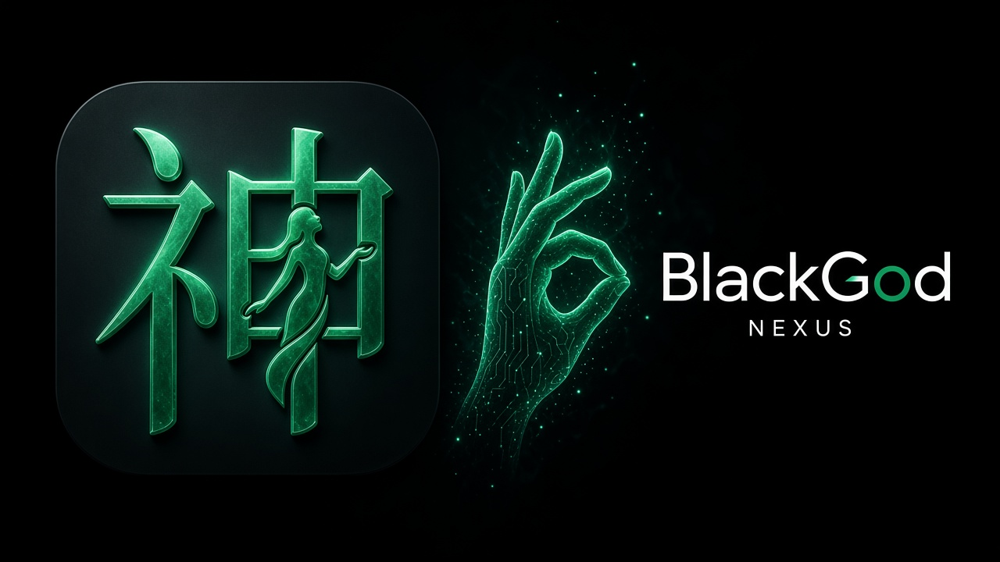
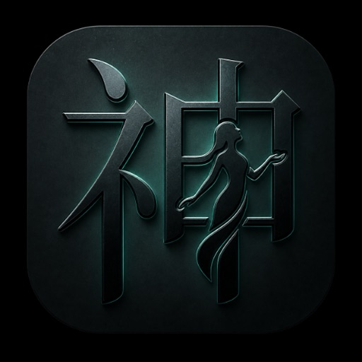

<div align="center">



<h3>🖐️ 用手语指挥 AI 助手</h3>
<p><i>Command your AI assistant — in your own language, on your own device.</i></p>

<p>
  <a href="https://apps.apple.com/cn/app/blackgod/id6809828368"></a>
</p>
<p>
  
  
  <a href="LICENSE"></a>
  
  
</p>

<b>中文</b> · <a href="#-english">English</a>

</div>

---

## 🜂 这是什么

**Black God（神枢 Nexus）** 是一款已上架 App Store 的 iOS AI 助手。它不绑定任何一家模型：你带上自己的密钥，接入 Claude、OpenAI、Gemini、OpenRouter 等服务商，在一部 iPhone 上完成 **对话、任务技能、长期记忆，以及本机 Linux 执行环境** 中的实际操作。

> **纯本机 · 零后端 · 密钥自备**
> 应用直接连接你所选择的模型服务商，开发者不运营任何中转服务器；密钥只保存在本机 iOS Keychain。

<table>
<tr>
<td width="25%" align="center">💬<br/><b>对话</b><br/><sub>多服务商、流式回复、多会话</sub></td>
<td width="25%" align="center">🧩<br/><b>任务技能</b><br/><sub>可保存、修订、演练的技能</sub></td>
<td width="25%" align="center">🧠<br/><b>长期记忆</b><br/><sub>由你确认、修正、删除</sub></td>
<td width="25%" align="center">🐧<br/><b>本机 Linux</b><br/><sub>应用内 Alpine 沙箱执行</sub></td>
</tr>
</table>

---

## 🌒 开发中：面向聋哑人的双向沟通 Agent

> 🚧 **开发中（In Development）** —— 以下能力尚未包含在 App Store 当前版本中，功能范围以正式发布说明为准。

我们正在为听障与言语障碍用户打造一个**双向沟通助手**：

| 方向 | 能力 | 说明 |
|---|---|---|
| 👂 → 👁️ 听 | **语音转大字幕（ASR）** | 把对方说的话实时转成高对比度大字幕，看得清、跟得上 |
| ✍️ → 🗣️ 说 | **打字 / 手语 → 语音代说（TTS）** | 用户输入的文字或识别出的手语，由手机朗读给对方听 |
| 🖐️ 识别 | **手语识别：指拼 + 词表** | 识别手指字母拼写与预设词表内的手语词汇 |

> ⚠️ **能力边界**：手语识别仅覆盖 **指拼（fingerspelling）与限定词表**，**不是通用手语翻译**，也不提供通用 ASL 翻译。请勿据此对外宣传为"通用手语翻译"。

---

## ✨ 功能模块

| 模块 | 能力 | 状态 |
|---|---|---|
| 🔌 **多模型连接** | Anthropic / Claude、OpenAI、Google Gemini、OpenRouter、DeepSeek、xAI / Grok、Moonshot / Kimi、智谱 GLM、阿里云百炼、腾讯混元等预设，另支持自定义 HTTPS 接口；协议覆盖 Anthropic Messages、OpenAI Chat Completions / Responses、Gemini generateContent | ✅ |
| 🔐 **账号与密钥** | 每个连接独立保存密钥于 Keychain；OpenRouter 支持 OAuth 登录 | ✅ |
| 💬 **对话** | 流式回复、停止 / 重试、多会话管理、对话清理 | ✅ |
| 🧭 **任务执行** | 先规划再执行，逐步记录证据，模型复核遗漏与矛盾；请求次数有上限，失败不会标为成功 | ✅ |
| 🧩 **任务技能** | 用户确认保存的技能，可检索、修订、恢复历史版本，内置技能可本地演练 | ✅ |
| 🧠 **长期记忆** | 仅保存用户明确确认的内容，可修正和删除；模型推断不会自动成为"事实" | ✅ |
| 🐧 **Linux 沙箱** | 应用内 Alpine 环境运行 Shell 命令，独立工作区、超时与输出上限，执行过程实时直播 | 🧪 实验功能 |
| ⚡ **快捷指令** | 通过 App Intents 从系统快捷指令调用 | ✅ |
| 🔣 **枢语 Shuyu** | 为 Black God 定制的指令语言引擎，JavaScriptCore 本地运行 | ✅ |
| 🤟 **无障碍沟通 Agent** | ASR 大字幕 · TTS 代说 · 手语指拼 / 词表识别 | 🚧 开发中 |

> 💡 `shuyu/` 目录是 **枢语（Shuyu / Pivot-Lang）** 引擎，与"手语"同音但是两个不同项目，请勿混淆。

---

## 🛠️ 构建

### 环境要求

- Apple Silicon Mac + Xcode（含 iOS SDK）
- [XcodeGen](https://github.com/yonaskolb/XcodeGen) 等构建工具
- 首次生成运行时镜像需要联网（下载固定版本的 Alpine 与 Meson，并校验 SHA256）

```bash
brew install xcodegen ninja llvm lld libarchive pkg-config
```

### 常用命令

| 命令 | 作用 |
|---|---|
| `make generate` | 构建 Linux 运行时（`tools/runtime/build.py`）→ 打包枢语资源 → `xcodegen` 生成 Xcode 工程 |
| `make build` | 无签名 Release 构建（`generic/platform=iOS`），用于验证源码可编译 |
| `make test` | 运行枢语测试 + iOS 测试 |
| `make test-shuyu` | 枢语资源一致性检查 + JS / Python 双实现测试 |
| `make test-ios` | iOS 模拟器测试，可用 `IOS_DESTINATION='platform=iOS Simulator,name=<设备名>'` 指定设备 |
| `make test-intelligence` | 智能核心回归（可在 Linux 上运行，不替代 Xcode 原生验证） |

```bash
git clone <this-repo> && cd blackgod
make build      # 生成工程并完成无签名构建
make test       # 运行全部回归
```

> 版本号、构建号与 Bundle ID 以 [`ios-app/project.yml`](ios-app/project.yml) 为准。

### 持续集成与发布

- **GitHub Actions**（`.github/workflows/`）：iOS 无签名构建与测试、智能核心回归、枢语 CI；不上传 App Store。
- **Codemagic**（[`codemagic.yaml`](codemagic.yaml)）：在 Mac mini M2 上 `make generate` → 签名 → 打包 IPA → 上传 **TestFlight**（不自动提交审核）。
- 签名证书与 App Store Connect 凭据通过发布平台的机密配置注入，**不写入仓库**。上架流程见 [提交指南](ios-app/AppStore/SUBMIT_GUIDE.md)。

---

## 🗂️ 目录结构

```text
.
├── ios-app/              # 原生 iOS 应用（SwiftUI）
│   ├── BlackGodApp.swift #   应用入口
│   ├── Nexus*.swift      #   任务运行时：模型桥接、工具、记忆、技能、沙箱、权限…
│   ├── Runtime/          #   Linux 运行时宿主
│   ├── ShuyuRuntime/     #   枢语资源（由 make generate 打包生成）
│   ├── AppStore/         #   商店文案、隐私政策、提交指南
│   ├── zh-Hans.lproj/ en.lproj/
│   └── project.yml       #   XcodeGen 工程定义
├── shuyu/                # 枢语 Shuyu 引擎（JS / Python）与测试
├── tools/                # 运行时构建、枢语打包、智能回归、发布脚本
├── tests/                # iOS / UI 测试与测试夹具
├── vendor/ish/           # 固定版本 iSH 内核源码快照
├── docs/                 # 架构、设计、质量与产品文档
├── assets/  ui-spec/     # 品牌资产与设计参考
├── web/  android/        # 历史资产（非当前 iOS 运行路径）
├── Makefile
└── codemagic.yaml
```

更详细的源码入口见 [STRUCTURE.md](STRUCTURE.md)，文档导航见 [docs/README.md](docs/README.md)。

---

## 🛡️ 隐私与安全

| | |
|---|---|
| 🚫 **开发者零收集** | 无自有后端、无广告与跟踪（`NSPrivacyTracking = false`），开发者不接收你的对话、记忆或密钥 |
| 🔑 **密钥本机** | 服务商密钥 / OAuth 凭据仅存于 iOS Keychain，不进入 Linux 沙箱，不上传任何开发者服务器 |
| 📱 **数据本机** | 聊天记录、长期记忆、技能与任务检查点保存在本机应用目录 |
| ➡️ **直连服务商** | 使用模型时，相关对话与上下文会**直接**发送给你选择的服务商，并受该服务商的隐私条款约束 |
| 🧱 **执行隔离** | Linux 沙箱拥有独立工作区，有超时与输出上限，禁止越过根目录、挂载与提权；属于开发期加固，尚非安全认证 |

> 隐私清单（`PrivacyInfo.xcprivacy`）中声明的"用户内容"仅用于应用功能，即发送给你所选模型服务商。完整说明见应用内隐私政策。

---

## 📄 License

Black God 原创源码以 **[MIT License](LICENSE)** 发布。

> ⚖️ 内置 Linux 运行时链接了 GPL 授权组件（iSH 等），含该运行时的二进制发行包**不能**被描述为仅 MIT 授权。第三方来源、许可证与对应源码发布要求见 [THIRD_PARTY.md](THIRD_PARTY.md)。

© 阿权 / 路飞 · Black God

---

<a id="-english"></a>

## 🌐 English

**Black God (神枢 Nexus)** is an iOS AI assistant available on the [App Store](https://apps.apple.com/cn/app/blackgod/id6809828368). Bring your own API keys for Claude, OpenAI, Gemini, OpenRouter and more — then chat, run reusable task skills, keep user-approved long-term memory, and execute real commands in an on-device Linux (Alpine) sandbox.

- **On-device, zero backend** — the app talks directly to the model provider you choose; no developer-operated relay server.
- **Your keys, your Keychain** — credentials are stored only in the iOS Keychain.
- **In development 🚧** — a two-way communication agent for Deaf and hard-of-hearing users: live ASR captions in large type, and typed or signed input spoken aloud via TTS. Sign recognition covers **fingerspelling and a limited vocabulary only — it is not a general-purpose sign-language (ASL) translator.**

**Build:** `brew install xcodegen ninja llvm lld libarchive pkg-config && make build && make test` (Apple Silicon Mac with Xcode).

**License:** original source under [MIT](LICENSE); bundled runtime includes GPL components — see [THIRD_PARTY.md](THIRD_PARTY.md).

<div align="center">
<br/>

<br/>
<sub>Black God · 神枢 Nexus — 黑中见玉，静而有光。</sub>
</div>
